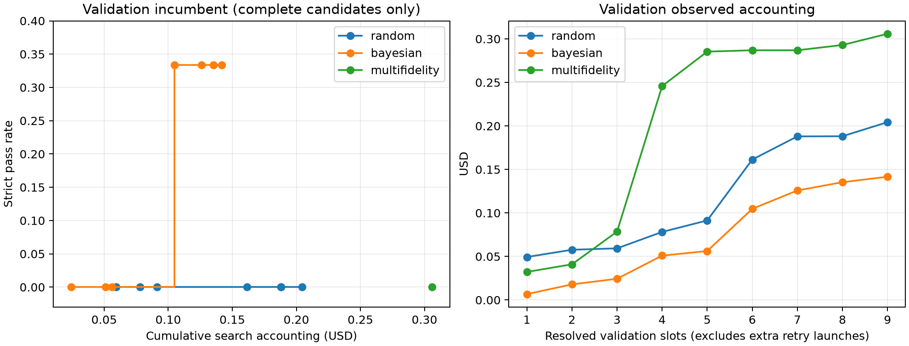

# 最终测试结果汇总

共 12 个测试槽位，10 项有效评分，2 项缺失，0 项通过。

| 方法 | 有效评分 | 通过 | 缺失 | 有效评分内通过率 | 已评分任务费用 USD | 失败未归因区间 USD |
|---|---:|---:|---:|---:|---:|---:|
| default | 2 | 0 | 1 | 0.0% | 0.06800400 | 0.00000000 |
| random | 3 | 0 | 0 | 0.0% | 0.06581122 | 0.00000000 |
| bayesian | 2 | 0 | 1 | 0.0% | 0.09615010 | 0.00000000 |
| multifidelity | 3 | 0 | 0 | 0.0% | 0.08904810 | 0.00000000 |

测试预算记账总额：USD 0.31901342。仅为测试阶段，不是整个项目总费用。

## 配置、验证与最终测试总表

| 方法 | 冻结配置 contextWindow / maxTokens | 入选候选验证通过 | 最终测试通过 / 有效项 | 测试缺失 | 搜索记账 USD | 测试记账 USD | 搜索加测试 USD |
|---|---|---:|---:|---:|---:|---:|---:|
| default | 默认，不覆盖参数 | 1 / 3（历史真实基线） | 0 / 2 | 1 | — | 0.06800400 | — |
| random | 64000 / 16384 | 0 / 3 | 0 / 3 | 0 | 0.20431264 | 0.06581122 | 0.27012386 |
| bayesian | 128000 / 4096 | 1 / 3 | 0 / 2 | 1 | 0.14163035 | 0.09615010 | 0.23778045 |
| multifidelity | 64000 / 16384 | 0 / 3 | 0 / 3 | 0 | 0.30581629 | 0.08904810 | 0.39486439 |

三种优化器搜索记账合计 USD 0.65175928；加上四种方法测试，已整理范围合计 USD 0.97077270。不包含早期 Default 基线、诊断探针和环境准备费用，不能称为整个项目总花费。

验证得分与测试得分分别报告，不合并计算通过率。Default 的搜索费用未适用，使用 —，不把未整理数据填成 0。

## 验证阶段搜索整理

验证题为 financial-modeling-qa、jax-computing-basics、travel-planning，与最终测试三题分离。以下验证分数用于选参，不是最终测试成绩。Default 未进行搜索，其历史真实验证基线在后面的独立章节列出。

| 方法 | 候选记录数 / 不同配置数 | 有效评分 / 缺失 | 实际启动次数 | 入选候选 | contextWindow | maxTokens | 入选候选验证通过率 | 搜索记账 USD |
|---|---:|---:|---:|---:|---:|---:|---:|---:|
| random | 3 / 3 | 8 / 1 | 10 | 0 | 64000 | 16384 | 0.0% | 0.20431264 |
| bayesian | 3 / 1 | 9 / 0 | 9 | 1 | 128000 | 4096 | 33.3% | 0.14163035 |
| multifidelity | 5 / 5 | 8 / 1 | 10 | 0 | 64000 | 16384 | 0.0% | 0.30581629 |

候选编号从 0 开始。三种搜索各有 9 个验证槽位；Random 和 Multifidelity 各有一次额外恢复启动、一次缺失。相同槽位上限不表示启动次数或实际费用相同。Bayesian 的三条候选记录使用同一配置，是独立重复评估，不是三个不同参数点。

### 候选配置与选择依据

| 方法 | 候选 | contextWindow | maxTokens | 已评分项通过数 / 有效项 | 缺失 | 完整三题、可入选 | 最终入选 |
|---|---:|---:|---:|---:|---:|---|---|
| random | 0 | 64000 | 16384 | 0 / 3 | 0 | 是 | 是 |
| random | 1 | 96000 | 4096 | 0 / 3 | 0 | 是 | 否 |
| random | 2 | 128000 | 4096 | 1 / 2 | 1 | 否 | 否 |
| bayesian | 0 | 128000 | 4096 | 0 / 3 | 0 | 是 | 否 |
| bayesian | 1 | 128000 | 4096 | 1 / 3 | 0 | 是 | 是 |
| bayesian | 2 | 128000 | 4096 | 0 / 3 | 0 | 是 | 否 |
| multifidelity | 0 | 64000 | 16384 | 0 / 3 | 0 | 是 | 是 |
| multifidelity | 1 | 96000 | 4096 | 0 / 2 | 1 | 否 | 否 |
| multifidelity | 2 | 128000 | 4096 | 0 / 1 | 0 | 否 | 否 |
| multifidelity | 3 | 128000 | 8192 | 0 / 1 | 0 | 否 | 否 |
| multifidelity | 4 | 64000 | 8192 | 0 / 1 | 0 | 否 | 否 |

仅完整完成三道验证题的候选可入选；排序按严格通过数、平均 reward、较低费用、较早候选。Random 候选 2 虽通过一题，但另有一题缺失，因此不具备入选资格；Multifidelity 的未晋级候选不能把未评估的任务当作失败。

### 搜索曲线

左图横轴为累计搜索记账费用（USD），纵轴为最佳验证通过率；仅在候选三题均有有效评分后更新，之前留空。右图辅助展示各槽位的累计费用和未归因区间。额外恢复启动的记录费用在本轮均为 0；这仅表示未观察到费用差额，不证明免费。两图均不包含最终测试。

现有记录不足以做可靠的单参数因果敏感性或消融结论：Bayesian 重复同一配置，各候选任务覆盖也不完全相同。此处整理配置观察结果，不将其称为已完成消融实验。

## 补充核对的真实 Default 验证基线

此前未纳入整理的三条真实基线记录现已找回并复制到 validation_default_evidence/；不是 demo 合成数据。它们早于优化器搜索和安装加固，原始 Linux jobs 尚未重新读取，以下来自保存的结果摘要。

| 验证任务 | Default reward | 入选 Bayesian 候选 reward | 观察对比 |
|---|---:|---:|---|
| financial-modeling-qa | 0.0 | 0.0 | 均失败 |
| jax-computing-basics | 0.0 | 1.0 | Default 失败、Bayesian 成功 |
| travel-planning | 1.0 | 0.0 | Default 成功、Bayesian 失败 |

Default 验证基线为 1/3，即 33.3%；历史基线观察费用 USD 0.14043120，单列而非当作 HPO 搜索费用。验证到包含补测的测试差距为 −33.3 个百分点。

两种成败相反的案例均来自验证集，不冒充最终测试案例；这是事后挑选的描述性比较，受随机性和环境差异影响，不足以证明配置引发该差异。未晋级/不完整候选和 demo 合成数据不用于补齐案例。

## 参数敏感性与泛化差距

[参数敏感性分析](parameter_sensitivity.md)使用现有验证记录，形成 6 组固定另一参数的对比；属于事后探索，尚不能可靠排名参数重要性。

| 方法 | 入选候选验证通过率 | 测试有效项内通过率 | 测试减验证 | 限制 |
|---|---:|---:|---:|---|
| random | 0.0% | 0.0% | +0.0 个百分点 | 仅三个测试任务 |
| bayesian | 33.3% | 0.0% | -33.3 个百分点 | 测试 1 项缺失，仅按有效项计算 |
| multifidelity | 0.0% | 0.0% | +0.0 个百分点 | 仅三个测试任务 |

上述差距是不同验证/测试任务集上的描述性比较。Bayesian 原始测试只有两项有效评分，不能把该差距当作无偏的完整测试估计或过拟合的因果证据。历史 Default 基线和包含补测的差距在独立章节说明。

## 协议修订后的补充测试

以下为观察原始失败后、依照 supplementary_test/amendment.json 各补一次的结果。原始主表和两项缺失记录保留，不覆盖、不取多次尝试的最高分。配置、任务和时限未改变。

| 方法 | 补测任务 | 补测状态 | 补测 reward | 新增费用 USD |
|---|---|---|---:|---:|
| default | python-scala-translation | complete | 0.0 | 0.01259510 |
| bayesian | python-scala-translation | complete | 0.0 | 0.00795120 |

### 包含补测的三题结果

| 方法 | 有效评分 | 通过 | 仍缺失 | supplemented pass@1 | 原始加补测执行记账 USD |
|---|---:|---:|---:|---:|---:|
| default | 3 | 0 | 0 | 0.0% | 0.08059910 |
| random | 3 | 0 | 0 | 0.0% | 0.06581122 |
| bayesian | 3 | 0 | 0 | 0.0% | 0.10410130 |
| multifidelity | 3 | 0 | 0 | 0.0% | 0.08904810 |

新增补测记账 USD 0.02054630；原始测试加补测合计 USD 0.33955972；搜索、原始测试及补测合计 USD 0.99131900。该范围仍不包含早期基线、诊断和环境准备。

Default 与 Bayesian 获得额外尝试，应披露公平性限制。补测后的 Bayesian 三题通过率为 0%，较入选候选验证通过率低 33.3 个百分点；这仍是小样本、不同任务集的描述性差距，不能单独证明过拟合。

补测日志已归档并核对结果 SHA-256。两次 Scala 源文件均能编译，但测试编译出现 21 个符号解析错误；未进入单元测试执行。代码质量启发式分数 88%/96% 不等于官方 reward。详见[失败分析](final_test_failure_analysis.md)及 final_test_evidence/supplementary_manifest.json。

## 每项最终测试

| 方法 | 任务 | 状态 | 得分 |
|---|---|---|---:|
| default | python-scala-translation | skipped_docker_failure | 缺失 |
| default | reserves-at-risk-calc | complete | 0.0 |
| default | threejs-structure-parser | complete | 0.0 |
| random | python-scala-translation | complete | 0.0 |
| random | reserves-at-risk-calc | complete | 0.0 |
| random | threejs-structure-parser | complete | 0.0 |
| bayesian | python-scala-translation | skipped_command_timeout | 缺失 |
| bayesian | reserves-at-risk-calc | complete | 0.0 |
| bayesian | threejs-structure-parser | complete | 0.0 |
| multifidelity | python-scala-translation | complete | 0.0 |
| multifidelity | reserves-at-risk-calc | complete | 0.0 |
| multifidelity | threejs-structure-parser | complete | 0.0 |

## 可用于报告的结论与限制

- 当前测试未观察到任何方法通过任务，不能据此声称某种优化方法优于其他方法。
- 12 个槽位来自 4 种方法各评估相同的 3 个任务，并非 12 道独立题目。样本很小。
- Default 的构建失败和 Bayesian 的无评分命令超时均为缺失，不能填成 0 分。
- Random 首题达到固定 600 秒模型时限，评分器给出 0 分；保留超时证据，不重跑。
- Random 与 Multifidelity 最终选择了相同配置；两者之间没有形成不同参数配置的比较。
- 费用来自专用 Key 的观察差额，受延迟记账影响；失败区间单列，不能解释为精确单任务费用。
- 原始测试日志已归档并核对 12 条结果；[失败分析](final_test_failure_analysis.md)及 final_test_evidence/ 保留编译、公式、结构断言证据。没有重新执行评分器。
- 失败分析：四组 Excel 均未通过公式及计算检查；四组 Three.js 均有结构或网格问题；两个有评分的 Scala 输出存在编译或测试接口错误，另外两个 Scala 槽位缺失。
- 验证配置、预算、费用横轴的 incumbent 曲线及探索性参数敏感性已整理；样本限制使参数重要性仍不能可靠判定。作业要求敏感性或消融方法，不要求两者分别完成。此项目前仅部分支撑要求。
- 两种方法各有一次额外恢复启动，预算比较并非完全一致；相同上限不要求相同实际费用，但额外启动的待遇差异需要披露。两个方向的失败对比已由历史真实 Default 验证基线提供，不能称为 held-out 对比或因果证据。
- 测试结果不用于重新选参。任何新增实验应另立协议并与本轮结果分开。
